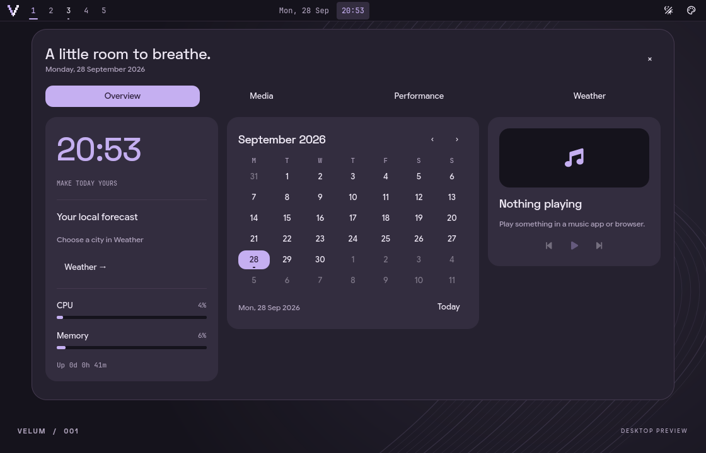

# Velum

A personal desktop for Arch Linux and Hyprland, built with Quickshell.
Soft surfaces, quiet color, and a little room to breathe.


Velum currently includes a top bar, appearance panel and clock dashboard. The
components and contour wallpaper are original QML, with no end-4, ML4W or
Caelestia imports. Those desktops are visual inspiration, not dependencies.

## Try the preview

Requirements: **Quickshell 0.2.1**, Qt 6 Quick/Controls, Bash, Python 3 and
JetBrains Mono Nerd Font (`ttf-jetbrains-mono-nerd` on Arch). Google Sans Flex
and Space Grotesk are optional fonts; Qt uses available fallbacks.

```bash
./scripts/velum
```

This opens a normal window. It does not install files, edit Hyprland, or stop
your existing shell. Click the workspace numbers, switch light/dark mode, and
open the **palette icon** to try Iris, Sage and Clay accents. Click the clock to
open the dashboard. Workspace selection in this preview is simulated; the clock,
system readings and media players are live. Escape closes an open panel;
Ctrl+Q or the window close button exits.

## Try the live bar

From a terminal inside Hyprland:

```bash
./scripts/velum --bar
```

Live mode adds a top bar to each connected monitor, with real workspace
switching, occupied-workspace indicators, the focused window title, date and
time. It runs alongside an existing bar, so the two may compete for space.
Press Ctrl+C in the launching terminal to stop Velum. Nothing is added to
autostart. The appearance panel's **×** button closes it.

## Clock dashboard

Click the centered clock to open a Caelestia-inspired dashboard built entirely
with Velum components. Close it with **Escape**, **×**, or a click outside.



- **Overview:** large clock, local forecast summary, month calendar, CPU/memory
  readings and media controls. Browse months, select a date, or return to Today.
- **Media:** select an MPRIS player, play/pause, skip tracks, seek and adjust
  that player's volume. Controls are enabled only when the player supports them.
- **Performance:** CPU history, memory/swap, disk usage, network transfer rates,
  uptime/load and available Linux thermal sensors. Metrics sample every two
  seconds while the dashboard is open.
- **Weather:** search for a city, choose among matching locations, and view
  current conditions and a five-day forecast in Celsius. Forecasts refresh
  every 15 minutes while open, or with the refresh button.

Weather uses [Open-Meteo](https://open-meteo.com/) and its GeoNames location
search. No request is made until a location is configured or a search is submitted.
The selected location is saved privately in `$XDG_CONFIG_HOME/velum/weather.json`
(normally `~/.config/velum/weather.json`), outside the repository. Network errors
are displayed in the Weather tab. Media discovery uses the session's MPRIS
services; no additional player daemon is required.

The calendar is a date browser, without appointments or account integration.
GPU metrics and per-process monitoring are not implemented. Small windows stack
the overview cards vertically; scroll inside the dashboard to reach them.

Theme choices are currently session-only. This first milestone does not provide
a launcher, tray, notifications, audio/network controls, locking, or display
settings. Keep your existing desktop services running.

## Project layout

```text
quickshell/
  shell.qml          Entry point: preview by default, live bar on request
  Preview.qml        Standalone design canvas
  Desktop.qml        Hyprland and monitor integration
  components/        Reusable interface components
  services/          Dashboard metrics and weather adapters
  theme/             Shared colors, typography and motion
scripts/
  velum              Launcher
  check              Syntax checks
  check-dashboard    Calendar, data and UI interaction checks
  dashboard/data.py  Standard-library metrics and weather helper
docs/
  design.md          Visual direction and next milestones
  installation.md    Fish/Neovim installers and clean-Arch VM checklist
config/              Independent Fish, Starship, Kitty and Neovim defaults
packages/            Explicit Arch package lists
tests/               Offline installer regressions
```

## Development

```bash
./scripts/check
./scripts/check-dashboard
```

Quickshell reloads edited QML files. Check both modes when changing shared
components. Syntax checks alone cannot validate live compositor behavior.

## Fish and Neovim on clean Arch

Portable installers are available for the terminal/editor portion of Velum:

```bash
./scripts/setup-fish --dry-run --set-shell
./scripts/setup-nvim --dry-run --with-powershell
```

See [installation instructions](docs/installation.md) before running with sudo.
They install explicit dependencies and shared defaults, preserve personal configs,
and back up conflicting system files when replacement is requested. They do not
install Hyprland or the full desktop yet. Fresh-Arch VM validation is still pending.

Run `./scripts/check-setup` for offline installer checks.

An optional capture hook saves **only the preview window** and exits:

```bash
VELUM_CAPTURE=/tmp/velum-preview.png ./scripts/velum
```

For the dashboard, add `VELUM_CAPTURE_DASHBOARD=1`. Optional `VELUM_CAPTURE_TAB`
selects Overview (0), Media (1), Performance (2), or Weather (3), and
`VELUM_PREVIEW_WIDTH` sets the preview width. Captures may contain real player
titles and system details; review them before sharing. `dbus-run-session --
./scripts/velum` isolates media discovery when creating a public screenshot.

Keep machine-specific files in ignored `local/`. Generated state, secrets,
clipboard databases and private account configuration do not belong here.

## References

- [Quickshell documentation](https://quickshell.org/docs/v0.2.1/guide/)
- [Hyprland integration](https://quickshell.org/docs/v0.2.1/types/Quickshell.Hyprland/Hyprland/)
- [Panel windows](https://quickshell.org/docs/v0.2.1/types/Quickshell/PanelWindow/)
