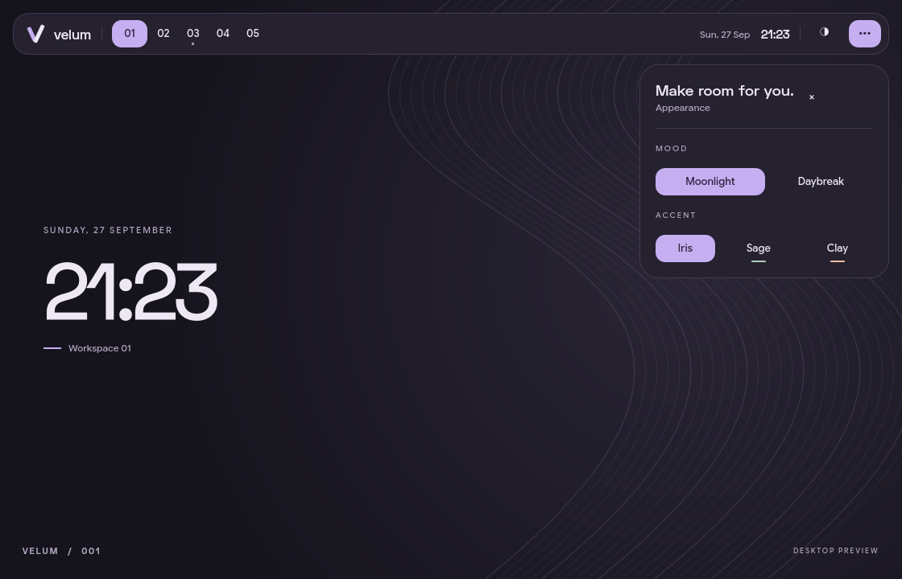

# Velum

A personal desktop for Arch Linux and Hyprland, built with Quickshell.
Soft surfaces, quiet color, and a little room to breathe.



This is the first UI milestone: a top bar and a small appearance panel. The
components and contour wallpaper are original QML, with no end-4, ML4W or
Caelestia imports. Those desktops are visual inspiration, not dependencies.

## Try the preview

Requirements: **Quickshell 0.2.1**, Qt 6 Quick/Controls, and Bash. Google Sans Flex
and Space Grotesk are optional fonts; Qt uses available fallbacks.

```bash
./scripts/velum
```

This opens a normal window. It does not install files, edit Hyprland, or stop
your existing shell. Click the workspace numbers, switch light/dark mode, and
open **•••** to try Iris, Sage and Clay accents. Workspace selection in this
preview is simulated; the clock is live. Escape closes the appearance panel;
Ctrl+Q or the window close button exits.

## Try the live bar

From a terminal inside Hyprland:

```bash
./scripts/velum --bar
```

Live mode adds a top bar to each connected monitor, with real workspace
switching, occupied-workspace indicators, the focused window title, date and
time. It runs alongside an existing bar, so the two may compete for space.
Press Ctrl+C in the launching terminal to stop Velum. Nothing is added to
autostart. The appearance panel's **×** button closes it.

Theme choices are currently session-only. This first milestone does not provide
a launcher, tray, notifications, audio/network controls, locking, or display
settings. Keep your existing desktop services running.

## Project layout

```text
quickshell/
  shell.qml          Entry point: preview by default, live bar on request
  Preview.qml        Standalone design canvas
  Desktop.qml        Hyprland and monitor integration
  components/        Reusable interface components
  theme/             Shared colors, typography and motion
scripts/
  velum              Launcher
  check              Syntax checks
docs/
  design.md          Visual direction and next milestones
```

## Development

```bash
./scripts/check
```

Quickshell reloads edited QML files. Check both modes when changing shared
components. Syntax checks alone cannot validate live compositor behavior.

An optional capture hook saves **only the preview window** and exits:

```bash
VELUM_CAPTURE=/tmp/velum-preview.png ./scripts/velum
```

Keep machine-specific files in ignored `local/`. Generated state, secrets,
clipboard databases and private account configuration do not belong here.

## References

- [Quickshell documentation](https://quickshell.org/docs/v0.2.1/guide/)
- [Hyprland integration](https://quickshell.org/docs/v0.2.1/types/Quickshell.Hyprland/Hyprland/)
- [Panel windows](https://quickshell.org/docs/v0.2.1/types/Quickshell/PanelWindow/)
